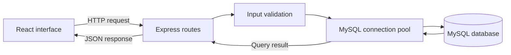
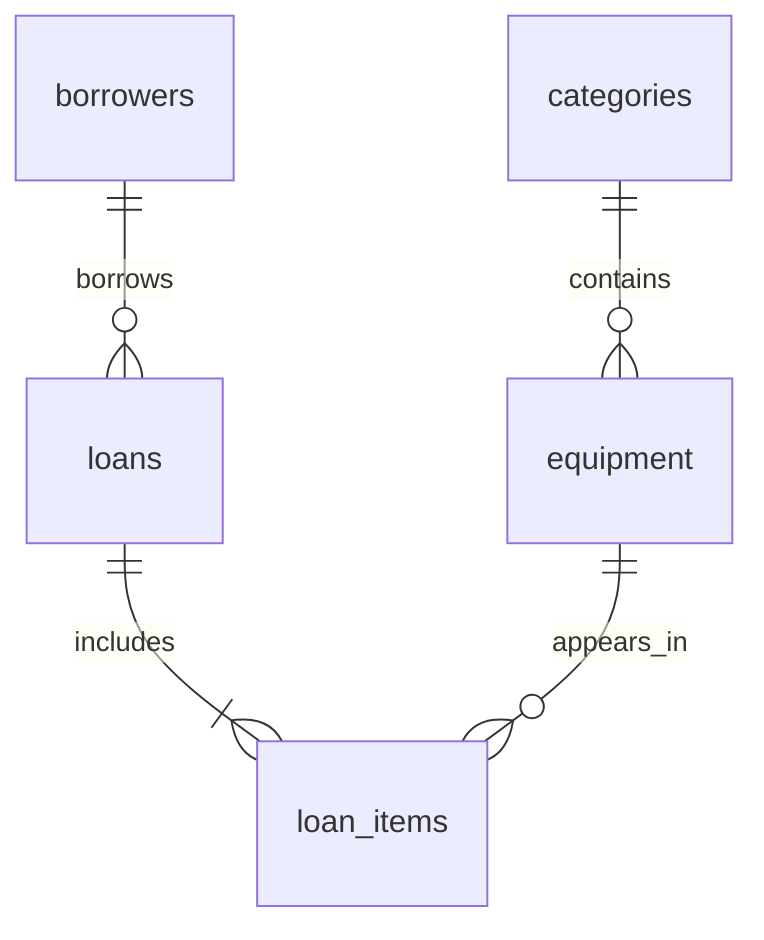

# 🎓 Campus Lending: Campus Equipment Management

Campus Lending manages equipment issued to students and staff. The application uses React and Express, with MySQL for equipment records and borrowing history. Staff can issue several items in one loan and record their returns separately.

---

## 🎯 The "Why"

A campus equipment desk needs to know which assets are available and who has borrowed each item. Campus Lending keeps those records in one interface. Unique equipment codes identify stock groups, while loan history connects each item to its borrower and due date.

This version is a local, single-operator academic project. It has no login or public deployment. The interface uses a black-and-white palette with gray shades for surfaces and statuses.

---

## 🛠 Tech Stack

* **Frontend:** React, JavaScript, Vite, plain CSS, Lucide icons
* **Backend:** Node.js, Express, mysql2, dotenv
* **Database:** MySQL 8.0.16+ with InnoDB tables

Node.js 22.12+ is required. Use a supported Node.js LTS release.

---

## ✨ Key Features

* **Equipment records:** Add, edit, and delete equipment types. Track total, borrowed, available, and maintenance quantities. Reduce the maintenance count after repairs.
* **Category management:** Create or rename equipment categories. Categories assigned to equipment cannot be deleted.
* **Borrower directory:** Find students by ID (`S00480` followed by three digits). Maintain their contact details and eligibility.
* **Loans and returns:** Limit each student to three outstanding items, one per equipment type. Edit due dates and inspect condition during returns. Damaged units enter maintenance automatically.
* **Dashboard:** View available equipment, items on loan, and overdue loans. Current loans appear in due-date order.
* **Search and filters:** Find equipment or borrowers and filter records by status. Dashboard and loan-register searches match student names/IDs, equipment names/codes, and due dates. Select a search field or search across all fields. Multiple search words must all match.

---

## 🔄 Application Architecture

React calls the Express API. Each route file contains the relevant validation and SQL queries. Database connections are handled in `backend/db.js`. Shared input checks are grouped in `backend/validation.js`.



The development frontend proxies `/api` requests to Express. A production build can be served by Express from the same address. Database credentials remain on the backend.

## 🗃️ Database Design

The database contains five tables.

| Table | Purpose | Relationships |
| :--- | :--- | :--- |
| `categories` | Equipment types | One category has many equipment items |
| `equipment` | Equipment types and stock counts | References `categories.id` |
| `borrowers` | Student or staff records | One borrower has many loans |
| `loans` | Issue date, due date, and notes | References `borrowers.id` |
| `loan_items` | Items in a loan and their return dates | References `loans.id` and `equipment.id` |



Every table has an integer primary key. Foreign keys protect related records. Asset tags, campus IDs, and email addresses are unique. Each loan can contain a given equipment type once. Backend transactions lock the borrower and equipment rows to enforce the three-item quota and prevent stock from being overbooked. Each loan item represents one unit.

A loan is overdue when its due date is earlier than the database's current date and at least one item remains unreturned. Dates follow the MySQL server's local calendar. Available stock equals total stock minus maintenance stock minus unreturned loan items. Stock edits cannot reduce the total below borrowed plus maintenance units.

---

## 🚀 Getting Started

### 1. Clone the Repository

```bash
git clone https://github.com/sriram629/campus-lending.git
cd campus-lending
git switch dev
npm ci
```

If working from the local project already prepared in VS Code, run commands from that project directory.

### 2. Create a MySQL Database

Start your MySQL server and open its administrative client:

```bash
mysql -u root -p
```

Run the following SQL. Replace the password placeholder with your own password.

```sql
CREATE DATABASE campus_lending
  CHARACTER SET utf8mb4 COLLATE utf8mb4_unicode_ci;
CREATE USER 'campus_user'@'127.0.0.1'
  IDENTIFIED BY 'REPLACE_WITH_YOUR_PASSWORD';
GRANT ALL PRIVILEGES ON campus_lending.*
  TO 'campus_user'@'127.0.0.1';
```

The account has permissions only on this project database. Schema setup needs table-creation permissions. The database should be empty before the first setup.

### 3. Environment Variables

```bash
cp backend/.env.example backend/.env
```

Edit `backend/.env`:

```dotenv
HOST=127.0.0.1
PORT=5002
DB_HOST=127.0.0.1
DB_PORT=3306
DB_USER=campus_user
DB_PASSWORD=YOUR_DATABASE_PASSWORD
DB_NAME=campus_lending
```

The prepared local installation uses a separate MySQL instance on port **3307**; its existing `.env` is already configured. For a normal MySQL installation, use its actual port, commonly 3306. Do not replace an existing `.env` unless you intend to change its settings.

Environment files are excluded from Git. `.env.example` contains a blank password. No external API keys are needed. Do not place database passwords in frontend files or in `VITE_` environment variables.

### 4. Initialize the Tables

```bash
npm run db:setup
```

This reads `database/schema.sql` and upgrades the previous individual-asset schema without deleting loan history. Fresh databases receive 24 equipment types with varied stock counts and three fictitious students (`S00480001`–`S00480003`). Sample loan dates are relative to the database's current date.

To add the demo catalog to an existing database explicitly:

```bash
node backend/db.js --setup --demo
```

This inserts missing demo equipment and raises matching demo stock to at least its sample quantity. Normal setup preserves stock counts. Original sample IDs `STU-1001`–`STU-1003` are converted to the new format when the target ID is unused. Other existing student IDs can be corrected through Borrowers.

### 5. Run Locally

```bash
npm run dev
```

Open [localhost:5173](http://127.0.0.1:5173). The frontend and backend run together. Express listens on port 5002, and the frontend proxies API requests to the configured backend port. Restart development servers after changing environment settings.

Press **Ctrl+C** in the terminal to stop both application servers. MySQL runs separately.

To run the servers in separate terminals:

```bash
npm run dev -w backend
npm run dev -w frontend
```

For a built frontend:

```bash
npm run build
npm start
```

Then open [localhost:5002](http://127.0.0.1:5002). This serves the built React interface and the API through Express. The application remains intended for local use.

### Prepared Local MySQL Instance

The local database prepared during development has its own data directory under the original Codex workspace. If that database is stopped, start it with this macOS command:

```bash
mysqld --no-defaults \
  --datadir=/Users/sriram/Documents/Codex/2026-11-10/design-and-develop-a-software-system/work/mysql-campus-data \
  --socket=/tmp/campus-lending-dev.sock \
  --port=3307 --bind-address=127.0.0.1 --mysqlx=0 \
  --log-error=/Users/sriram/Documents/Codex/2026-11-10/design-and-develop-a-software-system/work/mysql-campus.log \
  --pid-file=/Users/sriram/Documents/Codex/2026-11-10/design-and-develop-a-software-system/work/mysql-campus.pid
```

Use this command only for the prepared local installation. Other machines should create their own database using the setup steps above. MySQL runtime files and administrative credentials are outside the repository.

---

## 🔁 Lending Flow

1. Enter the student ID and select Find student. Review their details and remaining quota, then choose different equipment types and a due date.
2. Express validates the request and starts a transaction. Equipment rows are locked in ID order before their availability is checked.
3. The loan and its item records are inserted together. A failed check rolls back the transaction.
4. The interface refreshes the equipment list and dashboard counts.

Returns update only the selected loan items. If any selected item is invalid, the complete return request is rolled back. The remaining items stay on loan. Select whether each returned item is damaged. Damaged units increase maintenance stock within the same transaction. After repair, reduce the maintenance count in Equipment; those units become available again.

Records with borrowing history cannot be deleted through equipment or borrower CRUD. Keep the equipment record and adjust its stock, or mark a borrower Inactive to retain that history. Deleting a completed loan explicitly removes its item records too; open loans cannot be deleted.

---

## 📖 API Endpoints

| Method | Path | Purpose |
| :--- | :--- | :--- |
| GET | `/api/health` | Check database and schema connectivity |
| GET / POST | `/api/equipment` | List or create equipment |
| PUT / DELETE | `/api/equipment/:id` | Update or delete equipment |
| GET / POST | `/api/equipment/categories` | List or create categories |
| PUT / DELETE | `/api/equipment/categories/:id` | Update or delete categories |
| GET / POST | `/api/borrowers` | List or create borrowers |
| GET | `/api/borrowers/lookup/:campusId` | Look up student details, outstanding equipment, and quota |
| PUT / DELETE | `/api/borrowers/:id` | Update or delete borrowers |
| GET / POST | `/api/loans` | List loans or issue equipment |
| PUT / DELETE | `/api/loans/:id` | Edit due date/notes or delete a completed loan |
| POST | `/api/loans/:id/return` | Return selected loan items |

Loan creation accepts `borrower_id`, an `equipment_ids` array, `due_on` in `YYYY-MM-DD` format, and optional `notes`. Return requests contain `item_ids` from the loan's item records and `damaged_item_ids` (an empty array if none are damaged). Equipment writes require `quantity` and `maintenance_quantity` as whole numbers. Student IDs contain `S` plus eight digits and must match `S00480[0-9]{3}`. JSON errors include an `error` message.

---

## 📂 Project Structure

```text
campus-lending/
├── frontend/
│   ├── src/
│   │   ├── pages/
│   │   │   ├── Dashboard.jsx
│   │   │   ├── Equipment.jsx
│   │   │   ├── Borrowers.jsx
│   │   │   └── Loans.jsx
│   │   ├── App.jsx
│   │   ├── components.jsx
│   │   ├── main.jsx
│   │   └── styles.css
│   ├── index.html
│   ├── vite.config.js
│   └── package.json
├── backend/
│   ├── routes/
│   │   ├── equipment.js
│   │   ├── borrowers.js
│   │   └── loans.js
│   ├── db.js
│   ├── validation.js
│   ├── server.js
│   ├── .env.example
│   └── package.json
├── database/
│   └── schema.sql
├── .gitignore
├── package.json
├── package-lock.json
└── README.md
```

React forms stay with their respective pages. Shared interface components and the request helper are grouped in `components.jsx`. There are no separate controller, service, or model layers. This repository contains no automated test files or separate explanation documents.

---

## Development Dependency Note

The runtime dependency audit reports no known vulnerabilities. The full audit reports a `picomatch` regular-expression denial-of-service advisory through Vite's development dependencies. The registry's latest `picomatch` version was still affected when checked on November 17, 2026. Keep the development server bound to localhost and review the advisory before any public development-server exposure.

---

## 🔗 Links

* **Source Code:** [Campus Lending](https://github.com/sriram629/campus-lending)
* **Report Issues:** [GitHub Issues](https://github.com/sriram629/campus-lending/issues)
