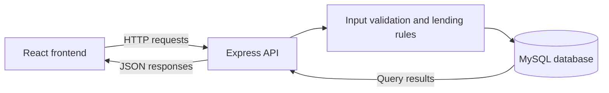
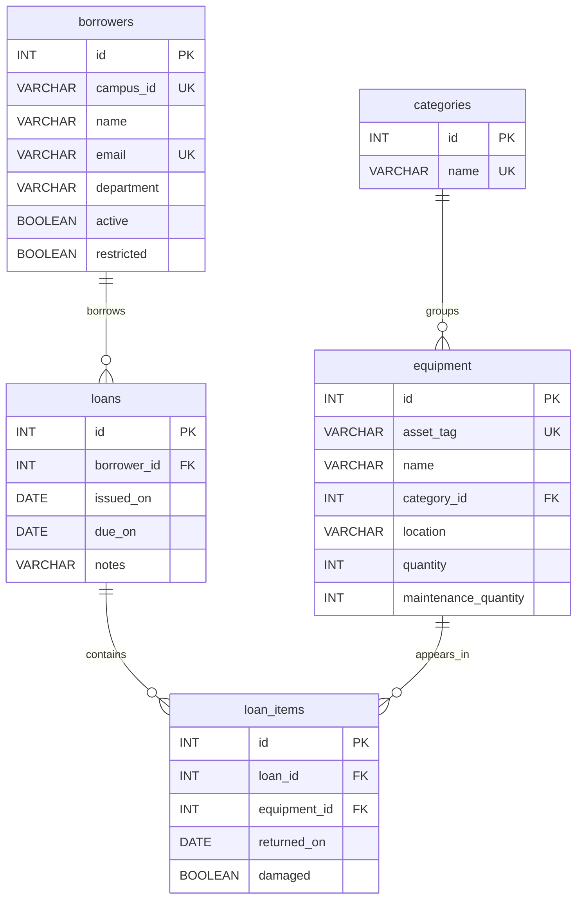

# Campus Lending

A campus equipment lending system built with React, Express and MySQL.

[Live application](https://campus-lending.onrender.com)

## Features

- Dashboard with available stock, outstanding items and overdue loans; edit and return actions are available from the current-loan register.
- Equipment and category management, with total, available, borrowed and maintenance quantities for each equipment type.
- Equipment search by name, code, category or location, with category and availability filters.
- Borrower management with name and student-ID search, active status and borrowing restrictions.
- Student lookup by ID when issuing a loan. IDs use `S00480` followed by three digits, such as `S00480013`.
- A maximum of three outstanding items per student, with only one unit of each equipment type at a time.
- Loan register with active, overdue and returned statuses; search by student, equipment or due date.
- Partial returns with a condition choice for each received item. Damaged items enter maintenance and restrict further borrowing.
- Separate controls for repaired stock and borrower clearance. Changes refresh the displayed records and counts.
- Black, white and gray interface, environment-based credentials, and Docker support.

The public application is a demonstration workspace with fictitious data and no login.

## Software and versions

The versions below are recorded in the project files. `package-lock.json` locks JavaScript dependencies, `.nvmrc` specifies Node.js, and Docker images are pinned by digest. `requirements.txt` records software versions; use npm to install JavaScript packages.

| Software or package | Project version | Use |
| --- | --- | --- |
| Node.js | 24.22.3 | JavaScript runtime |
| npm | 11.19.1 | Package installation and workspace commands |
| MySQL | 8.4.13 | Local relational database |
| Git | 2.40 or newer | Clone and manage the repository |
| Docker Engine | 28.5.1 or newer | Container runtime |
| Docker Compose | 2.40.3 or newer | Start the app and database together |
| React and React DOM | 19.3.1 | Frontend |
| Vite | 7.3.8 | Development server and frontend build |
| @vitejs/plugin-react | 5.2.0 | React support in Vite |
| lucide-react | 0.468.0 | Interface icons |
| Express | 5.3.0 | Backend APIs |
| mysql2 | 3.24.6 | MySQL connections and queries |
| dotenv | 17.4.2 | Backend environment configuration |
| concurrently | 9.2.5 | Start frontend and backend in development |

The hosted database uses MySQL 8.0. Docker Desktop includes Docker Engine and Compose. A code editor such as VS Code is optional.

## Recreate on your desktop

Choose either Docker or the manual setup. The public application uses demonstration data and has no login.

### 1. Clone the project

Install Git, then run:

```bash
git clone --branch dev https://github.com/sriram629/campus-lending.git
cd campus-lending
```

### 2. Run with Docker

Install and start Docker Desktop with Docker Compose. Node.js and MySQL are included in the containers, so separate installations are unnecessary for this option.

Copy `.env.example` to `.env` in the project root. On macOS/Linux:

```bash
cp .env.example .env
```

On Windows PowerShell, use `Copy-Item .env.example .env`. Open `.env` and set:

```dotenv
APP_PORT=5003
DB_PASSWORD=replace_with_your_app_password
MYSQL_ROOT_PASSWORD=replace_with_a_different_root_password
```

Use your own passwords, then start the application:

```bash
docker compose up -d --build --wait --wait-timeout 180
```

Open `http://127.0.0.1:5003`. The first start creates the tables and sample data. MySQL data remains in a Docker volume after a restart.

```bash
docker compose logs -f app
docker compose down
docker compose up -d
```

These commands show logs, stop the application, and start it again. Do not add `-v` to the stop command unless you intend to delete the database volume.

### Alternative setup without Docker

Install Node.js 24 with npm, MySQL Server 8.4, and Git. Start the MySQL service. Version references are recorded in `requirements.txt`; this is a software inventory, not a Python installation file. JavaScript packages are installed through `npm ci` using `package-lock.json`.

1. From the cloned project directory, install the packages:

   ```bash
   npm ci
   ```

2. Open the MySQL client as an administrator (`mysql -u root -p`) and run:

   ```sql
   CREATE DATABASE campus_lending CHARACTER SET utf8mb4 COLLATE utf8mb4_unicode_ci;
   CREATE USER 'campus_user'@'127.0.0.1' IDENTIFIED BY 'your_app_password';
   GRANT ALL PRIVILEGES ON campus_lending.* TO 'campus_user'@'127.0.0.1';
   ```

3. Copy the backend environment template:

   ```bash
   cp backend/.env.example backend/.env
   ```

   On Windows PowerShell, use `Copy-Item backend/.env.example backend/.env`. Set the values below in `backend/.env`, with the same password used in MySQL:

   ```dotenv
   HOST=127.0.0.1
   PORT=5002
   DB_HOST=127.0.0.1
   DB_PORT=3306
   DB_USER=campus_user
   DB_PASSWORD=your_app_password
   DB_NAME=campus_lending
   DB_SSL=false
   DB_POOL_SIZE=5
   ```

   Adjust the database host and port if your installation uses different values. Credentials belong in `.env` files, which Git ignores. The root `.env` is used by Docker Compose; `backend/.env` is used for manual setup.

4. Create the schema and start development mode:

   ```bash
   npm run db:setup
   npm run dev
   ```

   Open `http://127.0.0.1:5173`. The API runs at `http://127.0.0.1:5002`. If port 5173 is occupied, stop the earlier development server before running this command again.

5. To run the built application, stop development mode with Ctrl+C and use:

   ```bash
   npm run build
   npm start
   ```

   Open `http://127.0.0.1:5002`.

Initial data is defined in `database/sample-data.mjs`: 24 equipment types, 15 borrowers and 20 loans. It is inserted into an empty database during setup; ordinary restarts preserve existing records. Loan status changes with the due date.

## Architecture and workflows

### Application architecture



React page components contain the dashboard and registers. Shared forms and dialogs are grouped in `frontend/src/components.jsx`. Express routes are separated by equipment, borrowers and loans; the database connection and setup logic are in `backend/db.js`.

During development, Vite runs on port 5173 and forwards API requests to Express on port 5002 by default. In the built application, Express serves both the frontend and the APIs. Docker Compose runs the app and MySQL in separate containers, with the application available on local port 5003. The cloud deployment runs the Docker application on Render and connects to MySQL on Filess.io with TLS.

### Issue a loan

1. Enter a student ID and select **Find student** to retrieve the borrower details and outstanding items.
2. Check the remaining quota. Inactive or restricted borrowers cannot receive a loan.
3. Select available equipment types and a due date. A student may hold up to three different types across all open loans.
4. The API validates the request and locks the borrower and relevant stock rows within a transaction.
5. The loan and item rows are saved together. The interface refreshes the registers and availability counts.

A failed check rolls back the transaction. Parameterized SQL queries keep submitted values separate from query text.

### Return an item

1. Open **Return** from the dashboard or loan register.
2. Select the received items and choose the condition of each item.
3. A normal return makes the unit available again. A damaged return increases maintenance quantity and restricts the borrower in the same transaction.
4. After repair, update maintenance quantity in Equipment. Clear the borrowing restriction separately in Borrowers when appropriate.

A loan is **Returned** when all its items have a return date. An open loan is **Overdue** when its due date is earlier than the database's current date; otherwise it is **Active**.

### Manage records

Create and edit equipment or borrowers through their registers. Search and filters narrow the displayed results. Referenced records cannot be deleted because foreign keys preserve loan history; borrowers can be deactivated instead. Only loans with all items returned can be deleted.

## Database design

### Relational model

The database uses five InnoDB tables. Every `id` is an auto-incrementing integer primary key. The complete executable SQL is in `database/schema.sql`.

| Table | Columns and constraints |
| --- | --- |
| `categories` | `id` PK; `name VARCHAR(80)` unique |
| `borrowers` | `id` PK; `campus_id VARCHAR(40)` unique; `name VARCHAR(120)`; `email VARCHAR(254)` unique; `department VARCHAR(120)`; `active BOOLEAN` default true; `restricted BOOLEAN` default false |
| `equipment` | `id` PK; `asset_tag VARCHAR(40)` unique; `name VARCHAR(120)`; `category_id INT` FK; `location VARCHAR(120)`; `quantity INT` default 1; `maintenance_quantity INT` default 0 |
| `loans` | `id` PK; `borrower_id INT` FK; `issued_on DATE`; `due_on DATE`; `notes VARCHAR(1000)` default empty string |
| `loan_items` | `id` PK; `loan_id INT` FK; `equipment_id INT` FK; `returned_on DATE` nullable; `damaged BOOLEAN` default false; unique pair `(loan_id, equipment_id)` |

All columns are required except `loan_items.returned_on`, which remains null until return. SQL checks require nonnegative quantities, maintenance no greater than total stock, valid borrower Boolean flags, and a due date on or after the issue date.

### Entity relationship model




- `equipment.category_id` references `categories.id`: one category has many equipment types.
- `loans.borrower_id` references `borrowers.id`: one borrower has many loans.
- `loan_items.loan_id` references `loans.id`: one loan has multiple item rows. The API requires at least one item when issuing a loan.
- `loan_items.equipment_id` references `equipment.id`: one equipment type appears in many loan records over time.

`loan_items` resolves the many-to-many relationship between loans and equipment. Each row represents one borrowed unit; an equipment record stores the total quantity of a type. Foreign keys prevent deletion of referenced records.

Available units are calculated as `quantity - maintenance_quantity - unreturned loan_items`. A borrower may hold at most three different equipment types at once. The API checks the quota and stock inside a transaction. A damaged return increases maintenance stock and restricts the borrower. Staff update repaired quantities in Equipment and clear borrowing restrictions separately in Borrowers.

### Full executable SQL schema

Run the following as a MySQL user with permission to create the database and tables. The table definitions match `database/schema.sql`. For normal recreation, `npm run db:setup` also handles existing-schema updates and initial sample data.

```sql
CREATE DATABASE IF NOT EXISTS campus_lending
  CHARACTER SET utf8mb4 COLLATE utf8mb4_unicode_ci;
USE campus_lending;

CREATE TABLE IF NOT EXISTS categories (
  id INT AUTO_INCREMENT PRIMARY KEY,
  name VARCHAR(80) NOT NULL UNIQUE
) ENGINE=InnoDB;

CREATE TABLE IF NOT EXISTS borrowers (
  id INT AUTO_INCREMENT PRIMARY KEY,
  campus_id VARCHAR(40) NOT NULL UNIQUE,
  name VARCHAR(120) NOT NULL,
  email VARCHAR(254) NOT NULL UNIQUE,
  department VARCHAR(120) NOT NULL,
  active BOOLEAN NOT NULL DEFAULT TRUE,
  restricted BOOLEAN NOT NULL DEFAULT FALSE,
  CHECK (restricted IN (0, 1)),
  CHECK (active IN (0, 1))
) ENGINE=InnoDB;

CREATE TABLE IF NOT EXISTS equipment (
  id INT AUTO_INCREMENT PRIMARY KEY,
  asset_tag VARCHAR(40) NOT NULL UNIQUE,
  name VARCHAR(120) NOT NULL,
  category_id INT NOT NULL,
  location VARCHAR(120) NOT NULL,
  quantity INT NOT NULL DEFAULT 1,
  maintenance_quantity INT NOT NULL DEFAULT 0,
  FOREIGN KEY (category_id) REFERENCES categories(id),
  CHECK (quantity >= 0 AND maintenance_quantity >= 0 AND maintenance_quantity <= quantity)
) ENGINE=InnoDB;

CREATE TABLE IF NOT EXISTS loans (
  id INT AUTO_INCREMENT PRIMARY KEY,
  borrower_id INT NOT NULL,
  issued_on DATE NOT NULL,
  due_on DATE NOT NULL,
  notes VARCHAR(1000) NOT NULL DEFAULT '',
  FOREIGN KEY (borrower_id) REFERENCES borrowers(id),
  CHECK (due_on >= issued_on)
) ENGINE=InnoDB;

CREATE TABLE IF NOT EXISTS loan_items (
  id INT AUTO_INCREMENT PRIMARY KEY,
  loan_id INT NOT NULL,
  equipment_id INT NOT NULL,
  returned_on DATE DEFAULT NULL,
  damaged BOOLEAN NOT NULL DEFAULT FALSE,
  FOREIGN KEY (loan_id) REFERENCES loans(id),
  FOREIGN KEY (equipment_id) REFERENCES equipment(id),
  UNIQUE (loan_id, equipment_id)
) ENGINE=InnoDB;
```

## File structure

```text
campus-lending/
├── backend/
│   ├── routes/
│   │   ├── borrowers.js
│   │   ├── equipment.js
│   │   └── loans.js
│   ├── db.js                 # Connection, schema setup and initial data
│   ├── server.js             # Express API and built frontend
│   ├── validation.js
│   ├── .env.example
│   └── package.json
├── database/
│   ├── schema.sql
│   └── sample-data.mjs
├── frontend/
│   ├── src/
│   │   ├── pages/
│   │   │   ├── Dashboard.jsx
│   │   │   ├── Equipment.jsx
│   │   │   ├── Borrowers.jsx
│   │   │   └── Loans.jsx
│   │   ├── App.jsx
│   │   ├── components.jsx
│   │   ├── main.jsx
│   │   └── styles.css
│   ├── index.html
│   ├── vite.config.js
│   └── package.json
├── .env.example
├── .nvmrc
├── Dockerfile
├── compose.yaml
├── render.yaml
├── requirements.txt
├── package.json
├── package-lock.json
└── README.md
```
