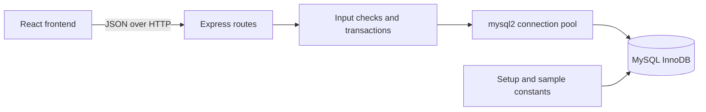
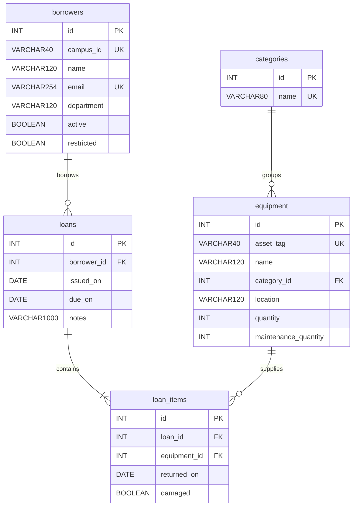

# 🎓 Campus Lending: Campus Equipment Management

Campus Lending is a local equipment desk application built with React, Express, and MySQL. Staff look up students by ID, issue equipment, inspect returned items, and manage stock and borrowing restrictions. The interface uses black, white, and gray.

**Live demo:** [campus-lending.onrender.com](https://campus-lending.onrender.com)

## 🎯 Features

- Equipment quantities: total, available, borrowed, and in maintenance. Equipment category filtering and text search.
- Student IDs from `S00480000` to `S00480999`: `S` plus eight digits. Borrower searches support name or ID.
- A maximum of three outstanding items per student, with one unit per equipment type.
- Active, overdue, and returned loans. Search by student, equipment, or due date, including combinations of search terms.
- Separate returns for individual items. Each received item requires a condition choice.
- Damaged returns increase maintenance stock and restrict the student. Borrowers → Update status clears a restriction after resolution. Repairing equipment does not clear the student's restriction.
- Dashboard counts and editing, equipment/category CRUD, borrower CRUD, and loan history.
- Initial sample data: 15 fictitious students, 24 equipment types, and 20 loans. On setup day, eight loans are active, seven overdue, and five returned.

This is an academic project without authentication. The public deployment is for fictitious demo records only; visitors can modify its data. GitHub stores the source, Render hosts the app, and Filess.io hosts the cloud MySQL database. Local Docker and native development remain available.

## 🛠 Software and Versions

| Component | Version used | Purpose |
| :--- | :--- | :--- |
| Node.js | 24.22.3 | JavaScript runtime; also recorded in `.nvmrc` |
| npm | 11.19.1 | Workspace dependency installation |
| MySQL | 8.4.13 | InnoDB relational database |
| Docker Engine | 28.5.1 | Verified container runtime |
| Docker Compose | 2.40.3 | Starts the application and database |
| Git | 2.40 or newer | Clone and branch management |
| React / React DOM | 19.3.1 | Frontend |
| Express | 5.3.0 | Backend API |
| mysql2 / dotenv | 3.24.6 / 17.4.2 | Database connection and environment settings |
| Vite / React plugin | 7.3.8 / 5.2.0 | Frontend development and build |
| Lucide React | 0.468.0 | Icons |
| concurrently | 9.2.5 | Runs both development servers |

`requirements.txt` records the software and direct package versions. It is an inventory for this Node.js project, not a Python/pip requirements file. `package.json` files pin direct npm versions, and `package-lock.json` locks the complete dependency tree. Always use `npm ci` to reproduce it. Docker base images are pinned by digest in `Dockerfile` and `compose.yaml`.

Install [Git](https://git-scm.com/downloads). For Docker setup, install and start [Docker Desktop](https://www.docker.com/products/docker-desktop/) on macOS/Windows, or install [Docker Engine](https://docs.docker.com/engine/install/) and its Compose plugin on Linux. Docker setup does not require Node.js or MySQL on the host. For native setup, install [Node.js](https://nodejs.org/en/download) and [MySQL Community Server](https://dev.mysql.com/downloads/mysql/). VS Code is optional.

## 🚀 Clone the Repository

Use a terminal, PowerShell, or Git Bash:

```bash
git clone --branch dev https://github.com/sriram629/campus-lending.git
cd campus-lending
git status
```

`main` is the default branch. `dev` contains development changes submitted through pull requests to `main`. To use a merged release instead, clone without `--branch dev`. An exact revision can be recreated with `git checkout COMMIT_SHA` after cloning.

Choose either Docker or native setup below. They use separate databases; records are not synchronized between them.

## 🐳 Docker Setup

### 1. Check the installed tools

Start Docker Desktop first, then run:

```bash
git --version
docker version
docker compose version
```

`docker version` must show both client and server information.

### 2. Configure credentials

Copy the root environment example:

```bash
cp .env.example .env
```

PowerShell equivalent:

```powershell
Copy-Item .env.example .env
```

Edit the root `.env` and supply two different passwords:

```dotenv
APP_PORT=5003
DB_PASSWORD=REPLACE_WITH_A_STRONG_APP_PASSWORD
MYSQL_ROOT_PASSWORD=REPLACE_WITH_A_DIFFERENT_ROOT_PASSWORD
```

Use long random alphanumeric passwords to avoid shell or Compose interpolation issues. Do not commit `.env`. The root `.env` is for Compose; `backend/.env` is for native development. Docker excludes both from its build context. Compose passes database settings to the containers at runtime. The database has no published host port, and the app is bound to localhost.

### 3. Build and start

From the repository root:

```bash
docker compose up -d --build --wait --wait-timeout 180
docker compose ps
```

Open [Campus Lending on port 5003](http://127.0.0.1:5003). The database health check runs before the app starts. The app applies schema setup and seeds an empty database before serving the built React frontend and API. A first image download can take several minutes.

```bash
curl http://127.0.0.1:5003/api/health
docker compose logs --tail=50 app db
```

The health endpoint should return `{"status":"ok","database":"connected"}`. On PowerShell, `Invoke-RestMethod http://127.0.0.1:5003/api/health` is an alternative to curl.

### 4. Stop, restart, or update

```bash
docker compose stop
docker compose start --wait
git pull --ff-only origin dev
docker compose up -d --build --wait --wait-timeout 180
```

`docker compose down` removes containers and the project network while preserving the `mysql-data` volume. It does not reset records. Rebuilding or restarting does not insert sample data into an existing database.

To deliberately erase this Docker database and recreate the sample data:

```bash
docker compose down --volumes
docker compose up -d --build --wait --wait-timeout 180
```

The `--volumes` command permanently removes the project database. Back it up first if its records are needed. Changing database passwords in `.env` does not change users inside an already initialized volume; retain the existing credentials or perform an intentional reset of disposable data.

### 5. Backup and restore

Create a backup inside the database container and copy it to the host:

```bash
docker compose exec db sh -c 'MYSQL_PWD="$MYSQL_PASSWORD" mysqldump -u campus_user --single-transaction --no-tablespaces campus_lending > /tmp/campus-backup.sql'
docker compose cp db:/tmp/campus-backup.sql ./campus-backup.sql
```

Restore only into the intended database; this replaces matching tables and data:

```bash
docker compose stop app
docker compose cp ./campus-backup.sql db:/tmp/campus-backup.sql
docker compose exec db sh -c 'MYSQL_PWD="$MYSQL_PASSWORD" mysql -u campus_user campus_lending < /tmp/campus-backup.sql'
docker compose start app --wait
```

Keep backups private. They are excluded from Git and Docker's build context.

## 💻 Native Development Setup

### 1. Install and verify Node.js and MySQL

Install the versions listed above and start the MySQL server using its platform installer/service manager. If nvm is already installed, `nvm install` and `nvm use` read `.nvmrc`.

```bash
node --version
npm --version
mysql --version
npm ci
```

`npm ci` installs the root, frontend, and backend workspace packages in one step. No Python packages are needed.

### 2. Create the database and application account

Open the MySQL administrative client:

```bash
mysql -u root -p
```

Run this SQL, replacing the password:

```sql
CREATE DATABASE campus_lending
  CHARACTER SET utf8mb4 COLLATE utf8mb4_unicode_ci;
CREATE USER 'campus_user'@'127.0.0.1'
  IDENTIFIED BY 'REPLACE_WITH_YOUR_PASSWORD';
GRANT ALL PRIVILEGES ON campus_lending.*
  TO 'campus_user'@'127.0.0.1';
```

These permissions are limited to the project database. Setup needs permission to create and alter tables.

### 3. Configure the backend

```bash
cp backend/.env.example backend/.env
```

On PowerShell, use `Copy-Item backend/.env.example backend/.env`. Edit it to match your database:

```dotenv
HOST=127.0.0.1
PORT=5002
DB_HOST=127.0.0.1
DB_PORT=3306
DB_USER=campus_user
DB_PASSWORD=YOUR_DATABASE_PASSWORD
DB_NAME=campus_lending
```

The original prepared development instance uses port 3307. A new installation normally uses 3306. Preserve a working existing `.env`. Never put secrets in frontend code or `VITE_` variables.

### 4. Set up tables and run

```bash
npm run db:setup
npm run dev
```

Open [the development frontend](http://127.0.0.1:5173). The API runs on port 5002; Vite proxies `/api` to it. MySQL must be running separately. Press Ctrl+C to stop the development servers.

To run frontend and backend in separate terminals:

```bash
npm run dev -w backend
npm run dev -w frontend
```

For a built frontend served by Express:

```bash
npm run build
npm start
```

Open [the built application](http://127.0.0.1:5002). Stop an existing backend on port 5002 first. Restart servers after environment changes.

### 5. Sample data and upgrades

`database/sample-data.mjs` contains the sample-data constants. Setup uses database-generated IDs to connect their records; it does not assume IDs begin at 1. Sample dates are offsets from the database date on the first setup day. Active samples naturally become overdue as time passes.

Normal setup populates only an entirely empty database. Existing data, edited quantities, dates, and restrictions remain unchanged. The setup also upgrades the earlier individual-asset schema to quantities without deleting loan history.

For an existing development database only, missing samples can be imported explicitly:

```bash
node backend/db.js --setup --demo
```

Docker equivalent:

```bash
docker compose exec app node backend/db.js --setup --demo
```

This optional import preserves existing records and identifies existing sample loans by `[Demo NN]` notes. Keep those notes unchanged if repeating the import. A quota, restriction, or availability conflict rolls back the sample import. App restarts do not refill deleted or edited samples.

## 🔄 Architecture and Workflows



Docker serves the frontend and API through Express at port 5003 on the host. Native development uses Vite at 5173 and Express at 5002. Shared code is grouped in `components.jsx` and `validation.js`; route files contain their SQL and request handling.

```mermaid
sequenceDiagram
    actor Staff
    participant UI as React
    participant API as Express
    participant DB as MySQL
    Staff->>UI: Enter student ID
    UI->>API: Look up student
    API->>DB: Read eligibility and outstanding items
    DB-->>UI: Details, restriction and quota
    Staff->>UI: Select different equipment and due date
    UI->>API: Issue loan
    API->>DB: Lock borrower and equipment; validate quota and stock
    API->>DB: Insert loan and loan_items; commit
    API-->>UI: Success; refresh all records
    Staff->>UI: Return selected items and choose condition
    UI->>API: Return with damaged item IDs
    API->>DB: Record return; add damaged stock to maintenance; restrict student
    API-->>UI: Success; refresh all records
```

1. Add categories and equipment with total and maintenance quantities.
2. Add a student with an ID matching `S00480[0-9]{3}`.
3. Issue a loan after ID lookup. Inactive or restricted students are blocked. Three outstanding items is the maximum across all their loans.
4. Edit due dates and notes from Loans or Dashboard. Due dates cannot precede the issue date.
5. Select received items and specify whether each is damaged. Unselected items stay on loan. Invalid return requests change nothing.
6. Damaged units enter maintenance and the student becomes restricted. Clear the restriction in Borrowers → Update status when resolved.
7. Reduce maintenance stock after repair. Available stock increases automatically. This does not restore student eligibility by itself.
8. Completed loans may be deleted. Open loans cannot be deleted. Equipment, borrowers, and categories referenced by other records cannot be deleted.

## 🗃️ Complete Database Design

The five tables use InnoDB. Integer primary keys are generated by MySQL. Relationships use foreign keys without cascading deletes. The application uses parameterized SQL, transactions, and row locks for stock and borrowing rules.

### Relational schema

```text
categories(id PK, name UNIQUE)
borrowers(id PK, campus_id UNIQUE, name, email UNIQUE, department, active, restricted)
equipment(id PK, asset_tag UNIQUE, name, category_id FK → categories.id,
          location, quantity, maintenance_quantity)
loans(id PK, borrower_id FK → borrowers.id, issued_on, due_on, notes)
loan_items(id PK, loan_id FK → loans.id, equipment_id FK → equipment.id,
           returned_on, damaged, UNIQUE(loan_id, equipment_id))
```

### Entity relationship diagram



A borrower can have many loans. A loan contains one or more items through the API; a foreign key alone cannot require that a parent has children. Equipment and loans have a many-to-many relationship through `loan_items`. Each equipment row represents a stock group, not an individually serialized unit; each loan item represents one unit from that group.

### Field dictionary

All columns are NOT NULL except `returned_on`. Primary keys are auto-increment integers. `BOOLEAN` is MySQL's `TINYINT(1)` alias.

| Table | Column | SQL type | Default / constraint | Meaning |
| :--- | :--- | :--- | :--- | :--- |
| categories | id | INT | PK, auto increment | Category ID |
| categories | name | VARCHAR(80) | Unique | Category label |
| borrowers | id | INT | PK, auto increment | Internal borrower ID |
| borrowers | campus_id | VARCHAR(40) | Unique; API validates format | Student ID |
| borrowers | name | VARCHAR(120) | Required | Full name |
| borrowers | email | VARCHAR(254) | Unique | Contact email |
| borrowers | department | VARCHAR(120) | Required | Academic department |
| borrowers | active | BOOLEAN | TRUE; CHECK 0 or 1 | Administrative eligibility |
| borrowers | restricted | BOOLEAN | FALSE; CHECK 0 or 1 | Damaged-return restriction |
| equipment | id | INT | PK, auto increment | Equipment type ID |
| equipment | asset_tag | VARCHAR(40) | Unique | Equipment code, retained column name |
| equipment | name | VARCHAR(120) | Required | Equipment name |
| equipment | category_id | INT | FK categories.id | Category |
| equipment | location | VARCHAR(120) | Required | Storage location |
| equipment | quantity | INT | 1; CHECK ≥ 0 | Total units owned |
| equipment | maintenance_quantity | INT | 0; CHECK 0…quantity | Units unavailable for repair |
| loans | id | INT | PK, auto increment | Loan reference |
| loans | borrower_id | INT | FK borrowers.id | Borrower |
| loans | issued_on | DATE | Required | Issue date |
| loans | due_on | DATE | CHECK ≥ issued_on | Due date |
| loans | notes | VARCHAR(1000) | Empty string | Purpose / notes |
| loan_items | id | INT | PK, auto increment | Individual loan line |
| loan_items | loan_id | INT | FK loans.id | Parent loan |
| loan_items | equipment_id | INT | FK equipment.id | Borrowed equipment type |
| loan_items | returned_on | DATE | NULL | NULL means still borrowed |
| loan_items | damaged | BOOLEAN | FALSE | Condition recorded at return |

### Keys, rules, and derived values

| Rule | Enforcement |
| :--- | :--- |
| Unique category name, student ID/email, equipment code | Database unique indexes |
| Valid parent references and protected history | Database foreign keys; no cascading deletes |
| One equipment type per loan | Database UNIQUE(loan_id, equipment_id) |
| Three outstanding items per student | API transaction and borrower row lock |
| One of each equipment type per student across open loans | API checks outstanding loan items |
| No overselling stock | API equipment row locks and current outstanding counts |
| Stock edits cover borrowed + maintenance units | API check while equipment row is locked |
| Required student ID format and valid email | API and form validation |
| Restricted/inactive students cannot borrow | API check; issue form also disables submission |
| Return and damage effects are atomic | API transaction |

```text
borrowed units = COUNT(loan_items WHERE equipment_id matches AND returned_on IS NULL)
available units = quantity − maintenance_quantity − borrowed units
student quota remaining = MAX(0, 3 − outstanding student loan_items)
Returned loan = no outstanding items
Overdue loan = outstanding items exist AND due_on < CURRENT_DATE
Active loan = outstanding items exist AND due_on >= CURRENT_DATE
```

Statuses and available counts are calculated, not stored. Due dates use the database calendar; Docker uses UTC. Returning one item does not mark the entire loan returned if other items remain outstanding. `damaged` preserves the return condition even after repair; `restricted` is separately cleared by staff.

MySQL creates indexes for primary/unique keys and supporting foreign keys. The schema separates categories, borrowers, and loan lines to avoid repeating those entities in loan headers. SQL checks enforce row-level stock/date conditions; cross-table quota and stock rules require the API and must not be bypassed with direct SQL writes.

### Full executable SQL schema

The following is also maintained in `database/schema.sql`. Create/select the database before running it. Use `npm run db:setup` for existing-schema upgrades and sample initialization.

```sql
CREATE TABLE IF NOT EXISTS categories (
  id INT AUTO_INCREMENT PRIMARY KEY,
  name VARCHAR(80) NOT NULL UNIQUE
) ENGINE=InnoDB;

CREATE TABLE IF NOT EXISTS borrowers (
  id INT AUTO_INCREMENT PRIMARY KEY,
  campus_id VARCHAR(40) NOT NULL UNIQUE,
  name VARCHAR(120) NOT NULL,
  email VARCHAR(254) NOT NULL UNIQUE,
  department VARCHAR(120) NOT NULL,
  active BOOLEAN NOT NULL DEFAULT TRUE,
  restricted BOOLEAN NOT NULL DEFAULT FALSE,
  CHECK (restricted IN (0, 1)),
  CHECK (active IN (0, 1))
) ENGINE=InnoDB;

CREATE TABLE IF NOT EXISTS equipment (
  id INT AUTO_INCREMENT PRIMARY KEY,
  asset_tag VARCHAR(40) NOT NULL UNIQUE,
  name VARCHAR(120) NOT NULL,
  category_id INT NOT NULL,
  location VARCHAR(120) NOT NULL,
  quantity INT NOT NULL DEFAULT 1,
  maintenance_quantity INT NOT NULL DEFAULT 0,
  FOREIGN KEY (category_id) REFERENCES categories(id),
  CHECK (quantity >= 0 AND maintenance_quantity >= 0 AND maintenance_quantity <= quantity)
) ENGINE=InnoDB;

CREATE TABLE IF NOT EXISTS loans (
  id INT AUTO_INCREMENT PRIMARY KEY,
  borrower_id INT NOT NULL,
  issued_on DATE NOT NULL,
  due_on DATE NOT NULL,
  notes VARCHAR(1000) NOT NULL DEFAULT '',
  FOREIGN KEY (borrower_id) REFERENCES borrowers(id),
  CHECK (due_on >= issued_on)
) ENGINE=InnoDB;

CREATE TABLE IF NOT EXISTS loan_items (
  id INT AUTO_INCREMENT PRIMARY KEY,
  loan_id INT NOT NULL,
  equipment_id INT NOT NULL,
  returned_on DATE DEFAULT NULL,
  damaged BOOLEAN NOT NULL DEFAULT FALSE,
  FOREIGN KEY (loan_id) REFERENCES loans(id),
  FOREIGN KEY (equipment_id) REFERENCES equipment(id),
  UNIQUE (loan_id, equipment_id)
) ENGINE=InnoDB;
```

### DBML representation

Paste this into a DBML-compatible database diagram editor. The executable SQL above is authoritative for CHECK constraints.

```dbml
Table categories {
  id int [pk, increment]
  name varchar(80) [not null, unique]
}
Table borrowers {
  id int [pk, increment]
  campus_id varchar(40) [not null, unique]
  name varchar(120) [not null]
  email varchar(254) [not null, unique]
  department varchar(120) [not null]
  active boolean [not null, default: true]
  restricted boolean [not null, default: false]
}
Table equipment {
  id int [pk, increment]
  asset_tag varchar(40) [not null, unique]
  name varchar(120) [not null]
  category_id int [not null, ref: > categories.id]
  location varchar(120) [not null]
  quantity int [not null, default: 1]
  maintenance_quantity int [not null, default: 0]
}
Table loans {
  id int [pk, increment]
  borrower_id int [not null, ref: > borrowers.id]
  issued_on date [not null]
  due_on date [not null]
  notes varchar(1000) [not null, default: '']
}
Table loan_items {
  id int [pk, increment]
  loan_id int [not null, ref: > loans.id]
  equipment_id int [not null, ref: > equipment.id]
  returned_on date
  damaged boolean [not null, default: false]
  indexes {
    (loan_id, equipment_id) [unique]
  }
}
```

## 📖 API Reference

All paths are relative to `/api`. Requests and responses use JSON. IDs in request bodies are internal numeric database IDs, except the lookup route's campus ID.

| Method | Path | Purpose |
| :--- | :--- | :--- |
| GET | `/health` | Database connectivity |
| GET / POST | `/equipment/categories` | List / create category |
| PUT / DELETE | `/equipment/categories/:id` | Rename / delete category |
| GET / POST | `/equipment` | List / create stock group |
| PUT / DELETE | `/equipment/:id` | Edit / delete stock group |
| GET / POST | `/borrowers` | List / create borrower |
| GET | `/borrowers/lookup/:campusId` | Student details, restriction, current items |
| PUT / DELETE | `/borrowers/:id` | Edit / delete borrower |
| PATCH | `/borrowers/:id/restriction` | Set or clear restriction |
| GET / POST | `/loans` | List / issue loan |
| PUT / DELETE | `/loans/:id` | Edit dates/notes / delete completed loan |
| POST | `/loans/:id/return` | Return selected items |

Request fields:

| Operation | JSON fields |
| :--- | :--- |
| Category | `name` |
| Equipment | `asset_tag`, `name`, `category_id`, `location`, `quantity`, `maintenance_quantity` |
| Borrower | `campus_id`, `name`, `email`, `department`, `active` (0 or 1) |
| Restriction | `restricted` (0 or 1) |
| Issue loan | `borrower_id`, `equipment_ids` array, `due_on` (`YYYY-MM-DD`), optional `notes` |
| Edit loan | `due_on`, optional `notes` |
| Return | `item_ids` array of loan-item IDs, `damaged_item_ids` subset (empty if none) |

Creation returns HTTP 201 with the new `id`; successful updates/deletes return 200. Errors contain `error`: 400 for invalid input, 404 for missing records, 409 for rule/relationship conflicts, and 503 for recognized database connection failures. An issue request can be rejected even after a successful lookup if another request changed availability or eligibility.

## 📂 Project Structure

```text
campus-lending/
├── backend/
│   ├── routes/
│   │   ├── borrowers.js
│   │   ├── equipment.js
│   │   └── loans.js
│   ├── db.js
│   ├── validation.js
│   ├── server.js
│   ├── package.json
│   └── .env.example
├── database/
│   ├── schema.sql
│   └── sample-data.mjs
├── frontend/
│   ├── src/
│   │   ├── pages/
│   │   │   ├── Dashboard.jsx
│   │   │   ├── Equipment.jsx
│   │   │   ├── Borrowers.jsx
│   │   │   └── Loans.jsx
│   │   ├── App.jsx
│   │   ├── components.jsx
│   │   ├── main.jsx
│   │   └── styles.css
│   ├── index.html
│   ├── vite.config.js
│   └── package.json
├── Dockerfile
├── compose.yaml
├── render.yaml
├── .dockerignore
├── .env.example
├── .gitignore
├── .nvmrc
├── requirements.txt
├── package.json
├── package-lock.json
└── README.md
```

No separate test or explanation files are maintained. The README contains setup and design documentation. Generated dependencies, builds, environment files, logs, and backup files are excluded from Git.

## 🔧 Troubleshooting and Verification

| Symptom | Action |
| :--- | :--- |
| Docker daemon unavailable | Start Docker Desktop; check `docker version` again |
| Empty password / Compose configuration error | Fill both password values in root `.env` |
| Port 5003 occupied | Change root `APP_PORT`, then run `docker compose up -d` |
| Port 5173 or 5002 occupied | Use the running app or stop its owning terminal; do not start duplicate development servers |
| Database connection refused | Start MySQL and verify native `backend/.env`, or inspect Docker DB logs |
| Schema missing | Run `npm run db:setup`; Docker does this automatically |
| UI shows old records | Use Refresh; reload after frontend changes |
| Student cannot borrow | Check Active status, restriction, quota, duplicate equipment, and stock |
| Stock edit rejected | Total must cover borrowed units plus maintenance units |
| Sample import conflict | Keep existing records; resolve the stated quota/stock conflict before an explicit reimport |

Ordered manual check: category → equipment → borrower → ID lookup → issue → dashboard/register → edit → partial return → damaged return → blocked issue → repair → status clearance → new issue → full return → delete completed verification records. Check quantities and eligibility after every mutation.

The Docker build and API workflow audit covered fresh seed counts, CRUD, quota checks, concurrent last-unit requests, return rollback, damaged returns, repair, and restriction clearance. Temporary audit records were removed afterward. Browser checks are useful for searches, form validation, and the same changes appearing across pages.

## 🔗 Repository

- [Source code](https://github.com/sriram629/campus-lending)
- [Development branch](https://github.com/sriram629/campus-lending/tree/dev)
- [Pull requests](https://github.com/sriram629/campus-lending/pulls)

## ☁️ Render + External MySQL Deployment

The live demo uses Render Free in Frankfurt and a Filess.io free MySQL database. The deployed database reports MySQL 8.0.46; the connection uses verified TLS. Initial cloud records are independent of local records. Automatic deployment is disabled: after pushing to `dev`, choose Manual Deploy → Deploy latest commit in Render.

The Docker web service can run on Render Free with a separately hosted MySQL database. `render.yaml` describes the web service only; it does not create or pay for a database. Use a new database containing only the fictitious sample data, because this academic app has no login and visitors can modify records.

1. Create a free MySQL 8 database with an external provider such as Filess.io. Retain its assigned database name, hostname, port, username, and generated password. Verify its current free-plan limits in the provider dashboard.
2. In Render, create a Web Service from `sriram629/campus-lending`, branch `dev`, runtime Docker, using the root Dockerfile. Choose the Free instance and a region near the database. A Blueprint deployment using `render.yaml` is an alternative.
3. Configure the following environment variables in Render. Enter credentials through the dashboard; do not commit them to Git.

| Variable | Render value |
| :--- | :--- |
| `HOST` | `0.0.0.0` |
| `PORT` | `10000` |
| `DB_HOST`, `DB_PORT` | Provider's database host and port |
| `DB_USER`, `DB_PASSWORD`, `DB_NAME` | Provider's generated credentials and database name |
| `DB_SSL` | `true` — enables TLS and verifies the server certificate |
| `DB_POOL_SIZE` | `2` — limits connections on a small shared database |
| `TZ` | `UTC` |

4. Set the health-check path to `/api/health` and disable automatic deployment if updates should be released manually. Deploy and wait for the service to become Live.
5. Open the assigned HTTPS URL and check `/api/health`, the dashboard, student lookup, and loan flows. The Docker startup initializes an empty database from the constants; redeploying preserves existing records.

Render Free may sleep after inactivity, so the next visit can take longer. The database remains with its external provider. Local Docker, native development, and this cloud deployment each have independent data. Keep local `DB_SSL=false` for the existing local MySQL setup; the cloud connection uses verified TLS. Database backups and storage limits are managed separately by the provider. See [Render free limits](https://render.com/docs/free) and [Filess.io plans](https://docs.filess.io/docs/pricing/plans/).
